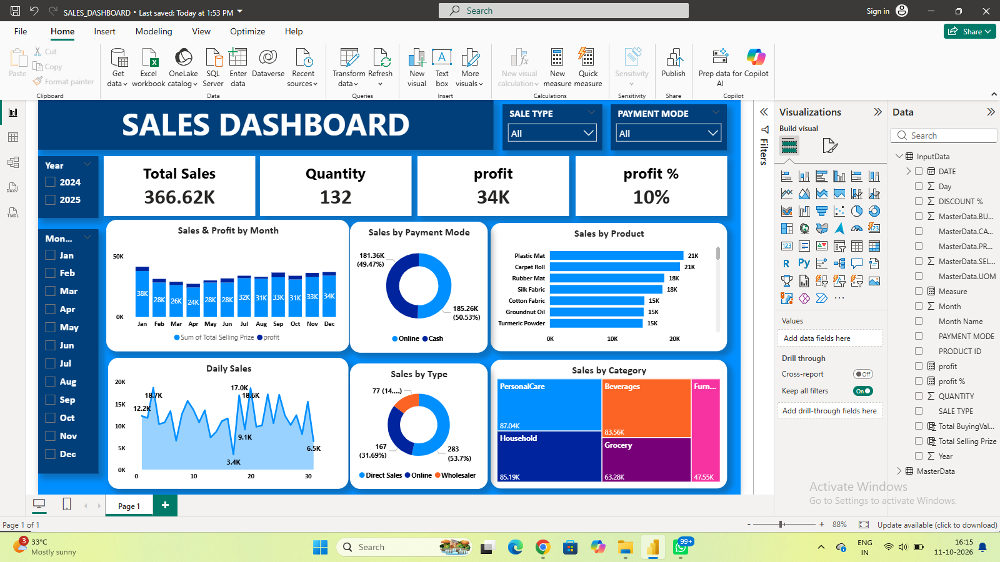

# Sales Analysis Dashboard | Power BI

## Project Overview

This project is an interactive Sales Analysis Dashboard developed using Microsoft Power BI to analyze sales performance, profit, products, payment methods, and sales categories. It helps users explore sales trends through interactive filters and visualizations.

## Dashboard Preview

## Tools Used

- **Microsoft Power BI** – Dashboard development and visualization
- **Power Query** – Data cleaning and transformation
- **DAX** – Creating measures and calculating KPIs

## Key Performance Indicators (KPIs)

- **Total Sales:** 366.62K
- **Profit:** 34K
- **Profit Percentage:** 10%
- **Quantity Sold:** 132

## Dashboard Features

- **Sales & Profit by Month:** Compares monthly sales and profit.
- **Sales by Payment Mode:** Shows the distribution of online and cash payments.
- **Sales by Product:** Identifies top-performing products.
- **Daily Sales:** Displays daily sales trends.
- **Sales by Type:** Compares Direct Sales, Online, and Wholesaler sales.
- **Sales by Category:** Visualizes sales distribution across product categories.
- **Interactive Slicers:** Filters data by year, month, sale type, and payment mode.

## Skills Learned & Demonstrated

- **DAX Measures:** Created measures to calculate sales, profit, and profit percentage.
- **Format Painter:** Applied consistent formatting across dashboard visuals.
- **Data Visualization:** Created bar charts, line charts, donut charts, and treemaps.
- **Interactive Slicers:** Added filters to explore sales data dynamically.
- **Dashboard Design:** Organized KPIs, charts, and filters into a user-friendly layout.
- **Data Analysis:** Explored sales trends across products, categories, payment methods, and months.

## Key Insights

- Online and cash payments contribute almost equally to total sales.
- Plastic Mat and Carpet Roll are among the leading products by sales.
- Monthly sales performance varies throughout the year.
- Personal Care and Household are among the leading categories by sales value.

## Learning Outcome

Through this project, I gained hands-on experience with Power BI measures, Format Painter, interactive slicers, and different visualization techniques. I also improved my ability to analyze sales data and present insights through an interactive dashboard.

## Project Objective

The objective of this project is to develop practical Power BI skills and understand how interactive dashboards can support sales performance analysis.

## Author

**Dilshath M**

MCA Student | Aspiring Data Analyst
